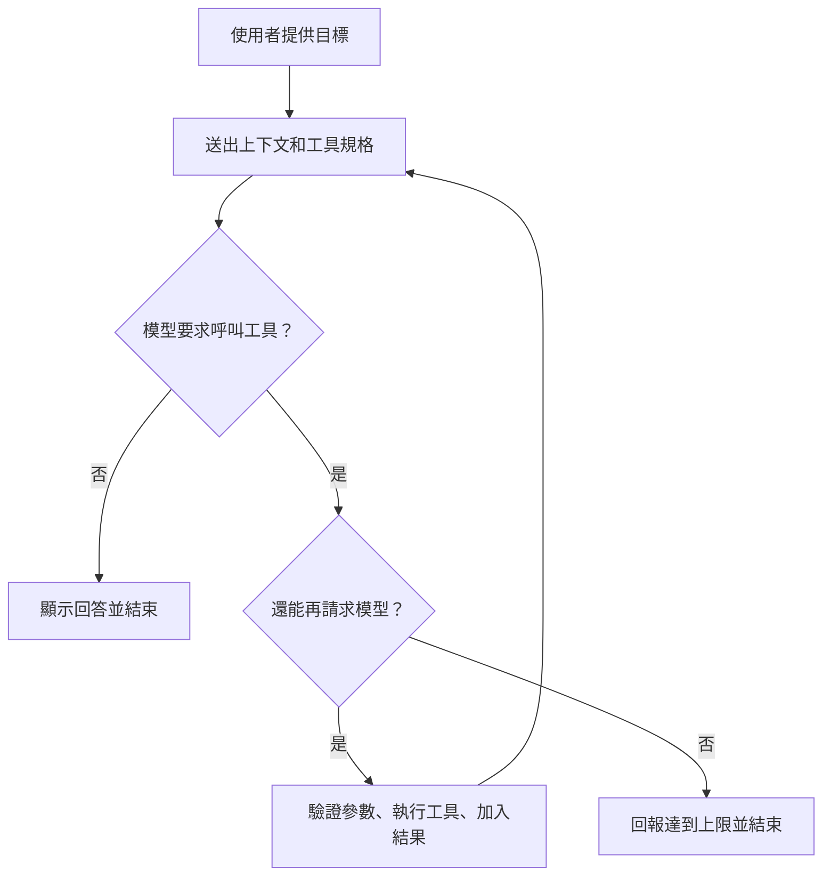

# 第 12 週｜從 LLM API 到 Agent

**現代軟體工程 · 林峻德（31）**

這份作業用一個「查詢作業」的例子，拆開四個階段。先送出一次 HTTP 請求，再把前一輪的訊息帶進對話，接著執行一次工具，最後讓模型依工具結果選擇下一步。讀完後，可以用終端機的紀錄說明每一輪是誰在決定、誰在執行，以及程式怎麼知道該停。

## 動手跑一遍

從儲存庫根目錄進入 `12`。需要 Python 3.10 以上，範例只用標準函式庫。以下指令使用程式內建的固定模型回應，實際執行本機查詢函式，不需網路或 API 金鑰。若 Windows 用 `py` 啟動 Python，把指令開頭的 `python` 換成 `py -3`。

```powershell
Set-Location .\12
python -X utf8 lab.py ask
python -X utf8 lab.py chat
python -X utf8 lab.py tool
python -X utf8 lab.py agent
```

| 階段 | 預設範例會請求模型幾次 | 觀察重點 |
| --- | --- | --- |
| `ask` | 1 | 使用者輸入經過一次請求，程式取出模型回應中的文字。 |
| `chat` | 2 | 第二次請求帶上第一輪的問題及回答。 |
| `tool` | 2 | 模型提出查詢，Python 執行一個工具，再把結果交給模型整理。 |
| `agent` | 3 | 模型先要求清單，再依清單選擇要查的作業，最後整理答案。 |

## 1. 一次 LLM API 請求

LLM 是語言模型。API 是讓程式把輸入交給模型、再取得回應的介面。在 `ask` 中，`request_model()` 組出 JSON，包含模型名稱 `model`、任務指示 `instructions` 和輸入 `input`。線上模式由 `send_openai()` 送出 `POST https://api.openai.com/v1/responses`，並在 HTTP 的 `Authorization` 標頭帶上金鑰。 [OpenAI API 快速入門](https://developers.openai.com/api/docs/quickstart)

原始 JSON 的 `output` 可以同時包含不同類型的項目。程式先找 `message`，再讀它的內容項目。例如 `output_text` 裡的 `text` 就是可顯示的回答。後面的工具階段會看到另一種輸出項目 `function_call`。 [Responses API 參考](https://developers.openai.com/api/reference/resources/responses/methods/create)

**動手看**　跑完 `ask`，找出「模型輸入項目」和「模型輸出項目」。在 [lab.py](lab.py) 裡追蹤 `request_model()` → `send_openai()` → `answer_text()`，找出文字從哪個 JSON 欄位來。

## 2. 對話的上下文

在 `chat` 中，第一輪說「我的練習專案叫『晨讀』」，第二輪只問「我剛才說的專案叫什麼？」。第二輪有三個輸入項目，依序是第一輪的使用者訊息、模型回覆，以及新的使用者訊息。`history` 由目前執行的 Python 程式保存在記憶體裡。

線上模式用 `store: false`，每次把需要的歷史放進 `input`。程式保留完整的模型輸出項目，工具請求和推理模型回傳的加密推理項目也會隨後續請求帶回。這個做法讓每次請求所帶的上下文可以直接在程式碼中追蹤。 [Responses API 推理模型指南](https://developers.openai.com/api/docs/guides/reasoning)

**先猜再跑**　第二輪問題本身沒有提到「晨讀」。指出第一次和第二次請求的差異。離線模式的回答是預設的，所以要讀輸入紀錄，或用 `test_chat_replays_history` 驗證第二次請求確實包含那三個項目。

## 3. 讓模型使用工具

在 `tool` 中，程式透過 `tools` 提供 `get_assignment` 的名稱、用途和參數規格。模型可以回傳一個 `function_call`，例如要求 `get_assignment`，其中 `arguments` 是字串 `{"code":"W12"}`。本機的 `call_tool()` 解析 JSON、檢查工具和參數，再讀取範例資料。 [OpenAI 函式呼叫指南](https://developers.openai.com/api/docs/guides/function-calling)

程式把模型提出的呼叫和執行結果都加進 `history`。執行結果用 `function_call_output` 表示，填入原本的 `call_id`，讓 API 能把結果配回正確的工具呼叫。這個階段第一輪要求呼叫工具，第二輪用 `tool_choice: "none"` 讓模型整理答案。一輪工具查詢用了兩次模型請求。

**動手看**　找終端機裡的 `call_detail`。比較 `tool` 和 `ask`，確認 `tool` 多了哪兩種輸入項目，以及繳交要求是在哪一步讀出來的。

## 4. 把工具接成 Agent 迴圈

目標是找出「截止日最早的未完成作業」，並回覆繳交要求。清單有日期和完成狀態，詳情才有繳交要求。程式將兩種工具都提供給模型，允許模型選擇工具或回覆。每次工具執行後，Python 把觀察到的結果加回上下文，供模型決定下一步。 [OpenAI Agent 迴圈說明](https://developers.openai.com/api/docs/guides/agents/running-agents)



範例先查清單。W11 已完成，W12 的截止日早於 W13，所以接著查 W12 的詳情。最後一輪用詳情中的要求回答。當問題已經提供作業代號，線上模式也可以直接查詳情。離線模式固定重播清單、詳情、回答三步，方便每次比對相同的流程。

程式掌握工具的執行權限。這兩個工具只讀取本機記憶體裡的範例資料。程式檢查允許的工具和參數，遇到未知代號會回傳錯誤。Agent 預設最多送出 5 次模型請求，若已是最後一次且模型仍要求工具，程式會報錯結束。若 API 回應狀態為 `incomplete`，程式會顯示原因並停止。

## 用 AI 對話，再回到程式驗證

下面的問答可在跑完四個階段後用來自測。先用自己的話回答，再把問題和執行紀錄貼給 AI，請它指出答案中哪部分有程式或輸出支持。

**問｜只把第二個問題送出去，模型從哪裡知道專案名稱？**

答｜第二個問題缺少名稱。這個範例靠 `history` 把第一輪的資訊附上。可以在 `chat` 的第二次請求確認這一點。

**問｜收到 `function_call` 時，作業資料已經被讀出來了嗎？**

答｜這時只有工具名稱和參數。接著由 `call_tool()` 查詢，結果才出現在 `function_call_output`。把第二輪請求的這兩個項目對照，就能看出模型和程式各自做了什麼。

**問｜為什麼工具查到作業後還要再送一次請求？**

答｜工具輸出的資料先回到程式，再附到模型輸入。模型看見結果後，才能比較候選資料、要求另一個工具，或整理出符合目標的回答。

**問｜如果需求永遠是「找出最早截止的未完成作業」，還需要 Agent 嗎？**

答｜可以直接用 Python 篩選未完成作業，再依日期取最早一筆，測試中的 `min()` 就示範了這個做法。Agent 的練習重點是讓模型根據不同問題決定要查哪些資料。

## 實驗紀錄

用 Python 3.13 執行了四個離線範例。下表的日期和要求來自程式中的教學資料。

| 實驗 | 觀察結果 |
| --- | --- |
| `ask` | 一次請求後取得一段 API 定義。 |
| `chat` | 第二次請求記錄 `user → message → user`，離線回答為「晨讀」。 |
| `tool` | `get_assignment` 執行一次，後續請求附有同一個 `call_id` 的結果。 |
| `agent` | 第 1 次查清單，第 2 次查 W12 詳情，第 3 次得到回答，截止日為 2026-12-04。 |
| `agent --max-steps 2` | 清單有執行，詳情沒有執行。顯示達到請求上限，結束碼為 1。 |

可重做上限實驗並執行測試：

```powershell
python -X utf8 lab.py agent --max-steps 2
$LASTEXITCODE
python -X utf8 -m unittest -v
```

7 項測試通過，涵蓋 HTTP 請求格式、對話歷史、工具呼叫與結果配對、Agent 正常結束和超過步數上限、工具參數錯誤，以及模型回應未完成。HTTP 測試以模擬回應檢查請求，這次環境沒有設定 OpenAI API 金鑰，線上呼叫尚未驗證。

## 接上真正的 LLM API

在 PowerShell 7 輸入自己的 OpenAI API 金鑰。金鑰留在目前終端機的環境變數，執行完即可移除。範例預設使用支援工具呼叫的 `gpt-5-mini`，也可以設定 `OPENAI_MODEL` 使用帳號有權限的模型。線上模式依 API 用量計費。 [GPT-5 mini 模型文件](https://developers.openai.com/api/docs/models/gpt-5-mini)

```powershell
$env:OPENAI_API_KEY = Read-Host -MaskInput "OpenAI API key"
python -X utf8 lab.py ask --live
python -X utf8 lab.py agent --live
python -X utf8 lab.py agent --live --question "只查 W13 的繳交要求。"
Remove-Item Env:OPENAI_API_KEY
```

比較兩次 Agent 的紀錄。第一次問多份作業，觀察是否先列清單。第二次已給代號，觀察是否直接查 W13。最後把兩次請求的工具順序、回覆和步數記下來，對照上面的離線結果。若模型走了不同的順序，先看它每一輪拿到了哪些工具結果，再問 AI 是哪個條件影響了下一步。
